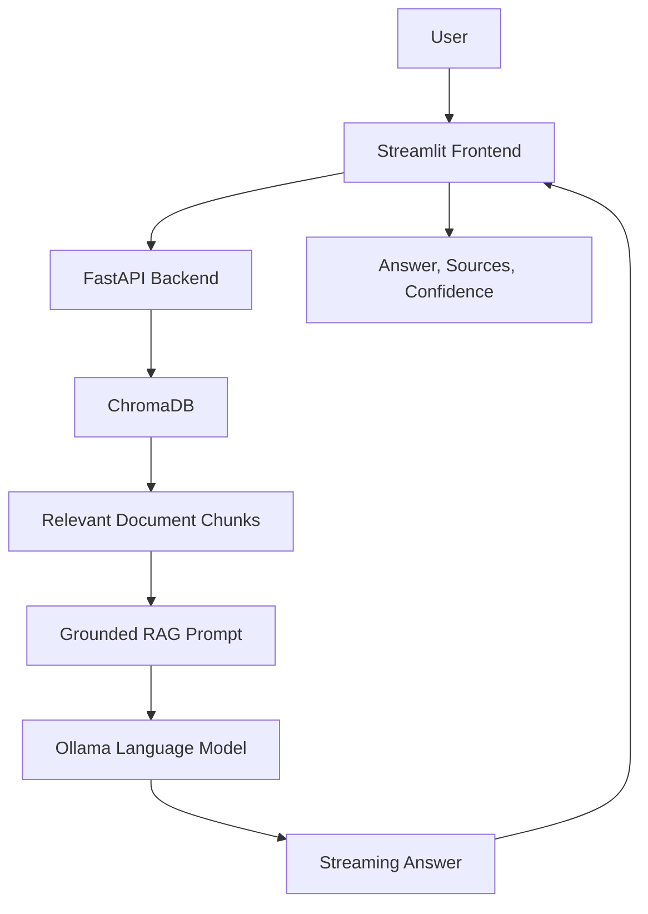

# RAG Pipeline

A local Retrieval-Augmented Generation (RAG) application built with **FastAPI, Streamlit, ChromaDB, and Ollama**.

The application retrieves relevant passages from a collection of six Python Enhancement Proposals (PEPs) and uses a locally hosted language model to generate answers grounded in the retrieved documents. Users can inspect source references and confidence information alongside generated responses.

The project emphasizes modular design, input validation, source transparency, automated testing, and responsible handling of questions that fall outside the available evidence.

## Features

- Semantic document retrieval using ChromaDB
- Persistent vector database storage
- Local language-model inference through Ollama
- Interactive Streamlit web interface
- FastAPI backend with request and response validation
- Streaming answers through Server-Sent Events (SSE)
- Source references and retrieval-confidence indicators
- Document ingestion through the API
- Health and statistics endpoints
- Input validation and readable error responses
- Docker Compose service orchestration
- Automated pytest coverage

## Architecture

The application consists of three services:

- **Frontend:** Streamlit interface for asking questions, viewing responses, and inspecting source information.
- **Backend:** FastAPI service responsible for ingestion, retrieval, answer generation, and API validation.
- **Ollama:** Local model-serving service used to generate answers from retrieved context.

### Request flow



Docker Compose manages the services and their network connections. Named volumes preserve the vector database and Ollama model data across container restarts.

## Technology Stack

| Component | Purpose |
|---|---|
| Python | Application implementation |
| FastAPI | Backend API |
| Streamlit | Interactive user interface |
| ChromaDB | Persistent vector storage and retrieval |
| Ollama | Local language-model inference |
| Pydantic Settings | Configuration validation |
| pytest | Automated testing |
| Docker Compose | Multi-service deployment |

## Project Structure

```text
rag-pipeline/
├── backend/
│   ├── Dockerfile
│   ├── config.py
│   ├── download_docs.py
│   ├── ingest.py
│   ├── main.py
│   ├── rag.py
│   └── requirements.txt
├── frontend/
│   ├── Dockerfile
│   ├── app.py
│   └── requirements.txt
├── docs/
│   ├── pep8.txt
│   ├── pep20.txt
│   ├── pep257.txt
│   ├── pep484.txt
│   ├── pep526.txt
│   └── pep585.txt
├── tests/
├── .env.example
├── .gitignore
├── docker-compose.yml
└── README.md
```

## Prerequisites

Install the following before running the application:

- Docker Desktop or Docker Engine with the Docker Compose plugin
- Git, if cloning the repository
- Sufficient disk space for Docker images, the local language model, and the vector database

A separate host installation of Python or Ollama is not required to run the complete Docker Compose application. Python is required if you want to run tests locally.

## Setup and Installation

### 1. Clone the repository

```bash
git clone <your-repository-url>
cd rag-pipeline
```

Replace the placeholder with the actual repository URL.

### 2. Create the environment file

Copy the example configuration:

```bash
cp .env.example .env
```

The default configuration is:

```dotenv
OLLAMA_URL=http://ollama:11434
MODEL_NAME=llama3.2:latest

CHROMA_PATH=./chroma_db
MAX_RESULTS=3
CONFIDENCE_THRESHOLD=1.0
DEBUG=false
```

The service URL uses `ollama` because Docker Compose provides service-name-based networking.

The default retrieval configuration requests three results. The confidence threshold controls the application's confidence classification; it does not guarantee that a generated answer is correct.

### 3. Build and start the services

```bash
docker compose up --build -d
```

Check service status:

```bash
docker compose ps
```

Check the service logs if needed:

```bash
docker compose logs -f backend
```

### 4. Download the Ollama model

Pull the configured model into the Ollama container:

```bash
docker compose exec ollama ollama pull llama3.2:latest
```

If the Ollama container is still starting, wait for it to become healthy before pulling the model.

The model must be available locally to Ollama before the application can generate answers.

### 5. Open the application

- **Streamlit frontend:** http://localhost:8501
- **FastAPI Swagger UI:** http://localhost:8000/docs
- **API root:** http://localhost:8000/

## Using the Application

1. Open the Streamlit frontend.
2. Check the displayed service health and document statistics.
3. Ingest the documents if the collection is empty.
4. Ask a question about the indexed PEP documents.
5. Review the generated answer, source references, and confidence information.

The frontend consumes the streaming API so that answer text can appear while generation is in progress. Retrieved source metadata is displayed with the completed response.

### Document ingestion

The backend provides a document-ingestion endpoint that loads supported documents from the configured `docs/` directory into ChromaDB.

If the collection has not been populated, use the application's ingestion control or the API's `POST /ingest` endpoint.

## API Reference

Interactive request and response schemas are available at `/docs`.

| Method | Endpoint | Purpose |
|---|---|---|
| GET | `/` | API root |
| GET | `/health` | Check ChromaDB and Ollama availability |
| GET | `/stats` | Return document statistics and configured model information |
| POST | `/ingest` | Ingest documents into ChromaDB |
| POST | `/ask` | Generate a non-streaming answer |
| POST | `/ask/stream` | Stream a generated answer and return response metadata |

### Streaming responses

`POST /ask/stream` returns a streaming response using Server-Sent Events (SSE). The frontend consumes the stream incrementally and handles answer text and final response metadata.

The non-streaming `POST /ask` endpoint remains available for clients that prefer a standard response.

### Error handling

The API includes validation and error handling for cases such as:

- Invalid or empty questions
- Missing document context
- Unavailable Ollama service
- Invalid configuration
- Document ingestion failures

Consult the interactive API documentation for the exact request schemas and response formats.

## Testing

Run the automated test suite from the repository root:

```bash
PYTHONPATH=backend python -m pytest backend/tests -q
```

The project has previously completed a run with **27 passing tests and 2 warnings**. Run the tests again against the final committed version before reporting a final result.

The tests cover application behavior such as retrieval, prompt construction, API validation, and error handling.

## Grounding and Evaluation

The application is designed to answer questions using retrieved document evidence rather than treating the language model as an unrestricted general-purpose assistant.

The system prompt instructs the model to:

- Use the retrieved context to answer questions.
- Avoid inventing unsupported information.
- Cite relevant source filenames.
- Distinguish explicit statements from inferences.
- Acknowledge when the retrieved documents do not support an answer.

### Example checks

**Answerable question**

Question: What naming convention does PEP 8 recommend for class names?

Expected behavior: Provide the CapWords convention and cite the relevant PEP source.

**Unsupported question**

Question: What does my private company's internal coding policy require?

Expected behavior: Acknowledge that the answer is not available in the provided documents.

These checks demonstrate the intended behavior of the grounding prompt. They are illustrative examples, not proof that every generated answer will be correct.

## Design Decisions

### Local inference

Ollama allows the model to run locally rather than requiring a hosted language-model API for generation.

### Separation of responsibilities

The frontend, backend, retrieval logic, and model service have distinct responsibilities. This makes individual components easier to maintain and troubleshoot.

### Evidence over assumptions

The system prompt emphasizes source attribution and explicitly discourages unsupported claims. Retrieval confidence and source references help users inspect the evidence behind a response.

### Controlled scope

The corpus is intentionally limited to six Python Enhancement Proposals. The application is a document-grounded RAG demonstration, not a complete Python tutor or a general-purpose knowledge system.

## Limitations

- Answers depend on the contents and quality of the indexed documents.
- Semantic retrieval can return related but insufficiently relevant passages.
- Confidence indicators are application-level heuristics, not calibrated probabilities of factual correctness.
- A grounding prompt reduces unsupported responses but cannot eliminate hallucinations.
- Local model speed and answer quality depend on available hardware and the selected model.
- The current corpus is limited to the included PEP documents.

## Future Improvements

Potential next steps include:

- Expanding document coverage with controlled ingestion
- Improving retrieval evaluation with a labeled question set
- Comparing retrieval and chunking configurations systematically
- Adding more robust source-level relevance checks
- Improving monitoring and diagnostics
- Expanding automated tests for streaming and failure cases

## Stopping and Restarting

Stop the services:

```bash
docker compose down
```

Start them again:

```bash
docker compose up -d
```

Named Docker volumes preserve ChromaDB and Ollama data when the containers are stopped and recreated.

To remove the containers and persistent volumes as well:

```bash
docker compose down -v
```

**Warning:** The `-v` option deletes the Compose-managed persistent data, including the local database and Ollama model storage.

